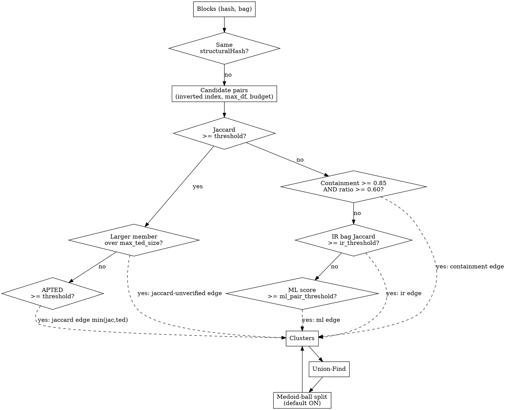

# Clustering algorithm

The clustering stage groups similar blocks into `Cluster` objects.

## Inputs

- Index: `BlockIndex` mapping block IDs → (structuralHash, ngramBag).
- Thresholds: `similarityThreshold` (0.80 by default), `treeThreshold` (0.85),
  containment `optional_blocks.containment` (0.85) with size-ratio floor
  `optional_blocks.min_overlap` (0.6), `ir_threshold` (0.85) and
  `ml_pair_threshold` (0.80) for the two optional rescuers.
- Candidate budget: `candidateBudget` (default 60,000,000; 0 = unlimited).

## Flow

```
Blocks (structuralHash, ngramBag)
   |
   +-- identical hashes --? --yes--> Phase 1 exact buckets --> emit exact clusters (see coverage rule)
   |
   +-- no --> generate candidate pairs (inverted n-gram index,
              boilerplate n-grams above max_df skipped, budget applied)
              |
              PairScoreWorker (forked or in-process) / serial engine:
              |
              +-- Jaccard >= 0.80? --no--> containment lens (optional_blocks):
              |                             Containment >= 0.85 AND
              |                             size ratio >= 0.60? --yes--> edge, tier 'containment'
              |                              --no--> IR arm (scorer=ir)? --yes--> edge, tier 'ir'
              |                                       --no--> ML arm (ml_pair_url)? --yes--> edge, tier 'ml'
              |                                                --no--> REJECT
              |
              +-- yes, but larger member over max_ted_size? --> edge, tier 'jaccard-unverified'
              |
              +-- yes, under cap: APTED (behind the size-delta + shapelet-sketch
                  pre-filters; the serial engine also charges its aggregate
                  APTED budget per pair)
                   |
                   +-- ted >= 0.85? --yes--> edge, tier 'jaccard', weight min(jac, ted)
                   |                       (first-wins: the tier records the lens
                   |                        that FOUND the match — there is no
                   |                        'ted' tier)
                   +-- no (refuted): serial engine drops the pair to the IR and ML
                       arms (containment stays closed); the fork engine rejects it
                       outright (twin gap, report-only — see Parallelism).
   (all edges above:)
   Union-Find on edges -> components
   Greedy medoid-ball split (DEFAULT ON) -> Clusters
```

Equivalently as a dot graph:



(The dashed edges are the tier-minting accepts, not stage outputs; the
`out -> uf -> split -> out` cycle reads "clusters assembled from the
edge set, then split". Same meaning as the numbered flow above.)

Steps:

(1) **Exact-hash clusters (Phase 1).** Blocks sharing a `structuralHash`
    are already duplicates; every bucket of ≥ 2 members becomes an
    `exact = true` cluster with similarity 1.0. Pair evidence: exact
    clusters carry an EMPTY `pairs` list (`Clusterer::buildExactPairs()`
    is a documented stub — the all-identical-bucket case "doesn't go
    through similarity scoring, so pairs are tracked as empty"). The
    structural hash equality IS the evidence; consumers must not expect
    per-pair rows for exact clusters (disclosed here because the CLI
    rows output empty for exact clusters — php-dup-finder-once-078
    DA-11).

    **Coverage rule at emission (engine-S15, engine-054).** A phase-1
    exact bucket is suppressed only when some emitted `exact=true`
    cluster already carries the WHOLE bucket. Otherwise — members that
    rode into a weaker near-dup cluster, or got split across medoid
    balls, or were never emitted at all — the bucket keeps its own
    exact headline alongside those clusters. Overlapping membership is
    therefore by design; triadic-closure tightening of ball membership
    is a documented non-goal.

(2) **Candidate pairs.** For non-exact pairs, use an inverted index on
    n-gram identity — two blocks sharing any n-gram are candidates. This
    replaces O(n²) pair enumeration with O(total n-grams) index building.
    Skips "boilerplate" n-grams appearing in more than `max_df`
    (max document frequency, 0.01 default) of blocks. The candidate
    stream is capped at `candidateBudget` pairs; overflow throws
    `CandidateBudgetException` (rendered as a `phpdup:` error line, exit
    1).

(3) **Jaccard similarity.** For candidate pairs, compute
    `|A ∩ B| / |A ∪ B|` over multiset n-gram fingerprints (bag sizes
    from each block's `ngram_size` n-grams). Below `similarityThreshold`
    → the pair continues to the containment/IR/ML ladder in step (4).
    Above threshold → the pair pays the tree cost gate: if the LARGER
    member exceeds `max_ted_size` (default 800 = the extraction ceiling,
    so the gate is inert unless explicitly lowered), the pair is accepted
    on the bag verdict alone, stamped `jaccard-unverified`; otherwise
    APTED runs on the two ASTs. APTED costs are computed once per pair;
    the result is `ted_sim`. The confirmed edge mints tier `jaccard`
    weighted `min(jac, ted_sim)` (first-wins tier policy — see
    `docs/adr/0003-similarity-stack.md`).

    A TED REFUTATION no longer ends the pair's story on the serial
    engine: refuted pairs fall through to the IR and ML arms (step 4) —
    but never to containment (refutation keeps a structural veto over
    bag restatement). The forked pair worker still rejects refuted
    pairs at the gate (see the Parallelism note).

(4) **Containment tier (type-3).** When `optional_blocks.enabled` (on
    by default) and the Jaccard gate REJECTED the pair (not merely
    TED-refuted — see step 3), compute containment score (below) and
    size ratio: containment >= 0.85 AND size ratio >= 0.60 → mark as
    a near-duplicate pair, tier `containment`, edge similarity = the
    containment score; AntiUnifier handles the optional-block alignment
    per step 3 of `docs/algorithms/anti-unification.md`. This tier catches
    subset clones like `{ a(); b(); }` vs `{ a(); b(); c(); }` that
    Jaccard penalises for size mismatch.

(5) **IR tier.** With `--scorer=ir` (default off), pairs still unclaimed
    after the Jaccard/containment gates are re-scored with an IR token-bag
    Jaccard; passes at or above `ir_threshold` emit `ir` tier edges.

(6) **ML pair tier.** With `--ml-pair-url`, still-unclaimed pairs are
    scored by the external model; a pass at or above `ml_pair_threshold`
    emits an `ml` tier edge. Unreachable → null → pair dropped.

(7) **Union-Find** merges every edge-connected component into a cluster.
    Near-subset and IR/ML-tier edges join components exactly like Jaccard
    edges.

(8) **Medoid-ball split** (default ON) — see the next section.

(9) **Similarity computation** per cluster.

## Medoid-ball split

**Default: on.** `Clusterer::DEFAULT_SPLIT_CLUSTERS = true` (with
`DEFAULT_MIN_SPLIT_SIZE = 2`). The pre-1.4 default-off posture this
document used to describe is history; today every shipped run that
does not construct `Clusterer` programmatically with `splitClusters:
false` gets the split. To opt out programmatically, pass
`splitClusters: false` when constructing `Clusterer` (no CLI flag).

After Union-Find, each component is one big cluster — which over-merges
through long "daisy chains" of near-threshold matches (a≈b≈c≈d with every
edge barely passing, but a vs d clearly different). Greedy medoid-ball
splitting tightens that:

- **Medoid** = the cluster member with the highest sum of edge similarities
  to other members (the "most central" clone). Deterministic pick:
  remaining-degree descending, then `structuralHash` ascending, then scan
  order (engine-052 keeps the degrees as incremental counters).
- **Ball** = the medoid plus every remaining member whose edge to the
  medoid is at or above the tier floor. The ball becomes its own cluster
  when it holds at least `minSplitSize` members.
- **Similarity** per sub-cluster = min pairwise similarity inside the
  sub-cluster; a sub-cluster's similarity is thus ≥ its parent component's.
  (With splitting off, component similarity remains the min over ALL
  member pairs — the legacy "daisy chain" measure.)
- **Residue handling** (the old-behaviour escape hatch): a ball below
  `minSplitSize` dissolves into a residue pool; ≥ 2 residues form one
  legacy-semantics cluster (weakest-edge-on-connecting-path similarity);
  a lone straggler tethers to the group holding its strongest edge.

The split consumes only the materialized edge list (`Cluster::$pairs`),
so membership runs on the composite tier truth that actually accepted
each pair — never CoherenceAnalyzer's raw-Jaccard basis.

## APTED pre-filters

APTED (the tree edit distance) is quadratic. Before paying for a pair:

- **Size-delta gate**: `|nodeCount(a) − nodeCount(b)| >
  ceil((1 − threshold) × max(nodeCount(a), nodeCount(b)))` → refuse.
  The absolute value is load-bearing (older prose wrote the difference
  without it, which reads as never tripping when b is the larger tree).
  The "no number of matches could close the gap" law behind this gate
  is the UNIT-cost identity; under `semantic` weights it degrades to a
  cheap conservative screen (see `docs/adr/0003-similarity-stack.md`).
- **Worst-case cost**: under `default` weights the maximum edit cost is
  `nodeCount(a) + nodeCount(b)` (unit costs); the actual similarity
  denominator is the weighted worst-case — the sum of the two trees'
  per-node costs under the active `EditCostModel` — so the reported
  number is honest for both cost tables. The pair budget
  `ceil((1 − threshold) × worst)` is what the banded DP is run against;
  a distance that cannot land inside it comes back as REFUSE.
- **Shapelet sketch**: a 64-bit histogram over `(nodeType, depth)` buckets
  (depth saturates at 63). Sketch similarity = Hamming-based overlap. If
  it falls below `threshold / 2` (a loose bound — tree-edit similarity is
  upper-bounded by bucket overlap) the pair is refused without an APTED
  run. Computed in one tree walk per tree, cost is cached by tree size.

Both gates are evaluated at the top of every entry path (cold or
memo-warm), so the tuple memo can never serve a verdict the gate would
have refused. Under the `default` edit-cost model these are pure
performance optimisations; they change nothing about which pairs
eventually score. The shapelet gate is skipped for `threshold = 0`
callers.

## Containment similarity

`ContainmentSimilarity` answers the "one block is a near-subset of the
other" question directly, and is the tier-3 scoring mechanism (see
ADR-0003).

- **Containment** = `|A ∩ B| / min(|A|, |B|)` — multiset intersection over
  the smaller bag's total mass. In `0..1`; 1.0 means the smaller bag's
  n-grams are all present in the larger one.
- **Size ratio** = `min(|A|, |B|) / max(|A|, |B|)` — how comparable the
  bags are in mass (prevents pairing a 1-line block with a 100-line one).

The Clusterer accepts a pair when containment ≥ `optional_blocks.containment`
(0.85) AND size ratio ≥ `optional_blocks.min_overlap` (0.6). Both bounds are
measured over n-gram multisets (bag *mass*, not raw token counts):
`{ a(); b(); }` vs `{ a(); b(); c(); }` lands high containment with a reduced
size ratio, while a same-size reorder lands high on both; AntiUnifier's LCS
pass (step 3 of anti-unification.md) does the statement-level alignment.

## IR tier (`--scorer=ir`, default off)

Pairs unclaimed by the AST-level tiers above (the Jaccard / containment
band) are re-scored with an intermediate-representation token bag. The
`IrLifter` lowers a block AST to a compact token sequence: variable
references, literal values and the call/assignment/operator ops are
emitted with the same stable grammar on both sides, so
structurally-similar-but-AST-divergent clones (differently nested,
same read-compute-write shape) end up with overlapping token bags.

`NgramFingerprint` then fingerprints the sequence exactly as it does the
AST token stream, and Jaccard scores the pair; `ir_threshold` (0.85 by
default) gates the edge (which carries the `ir` tier). The stage is a
cheap last-chance for type-4-adjacent clones without paying tree cost.

## ML pair tier (`--ml-pair-url`, default off)

The final fallback before rejection is an external pair-similarity
model: `MlPairClient` POSTs an `PairFeatures` token-bag vector
(from `PairFeatures::fromBlocks`) to `<url>/score-pair` and
reads a similarity score back. At or above `ml_pair_threshold` (0.80) the
pair gets an `ml` tier edge weighted by the score; **null** (server
unreachable) means no edge is added — the pair is silently treated as a
non-match.

`PairFeatures` (and the client) never carry raw source text, names,
or file paths — the request body is structural signal only (node counts,
operator/statement histograms, Jaccard floor, bag sizes, …) so the
sidecar sees no proprietary logic. Sidecar deployment is local-only in
practice: the transport refuses non-loopback hosts by shape (SSRF
posture, see `docs/ML.md`), the request is a plain POST, and a private
address family needs the root-only config key `ml_pair_allow_private`
(no CLI flag at this tip). The model is an oracle, not an authority:
it only ever ADDS an edge the AST tiers declined,
never re-weights or removes an existing one.

## Union-Find

Path-compressed Union-Find maps block IDs to roots; each connected
component (set of blocks linked by edges accepted above) becomes one
cluster before medoid splitting. (The old daisy-chain over-merge it
could not see past is precisely what the default medoid split closes.)

## Cache

`ClusterCache` (on by default): every finished run saves a summary
(cluster list + the corpus fingerprint); the next run checks
whether corpus + config match the saved state — if yes, the heavy
work (candidate pairs, Jaccard, APTED, containment, union-find, split)
is replaced by a snapshot replay.

On a re-run over an unchanged corpus the cache hit replays the
cluster set into the pipeline state and zeroes the cluster-stage
timing. What it does NOT do is skip Refactor: the stored payloads are
stripped of their `generalizedAst` by design, so on every hit the
RefactorStage re-runs anti-unification fresh against the replayed
members. "On re-run over unchanged corpus, skip Cluster + Refactor
stages entirely" is what this section used to promise; the second
half was never true of the shipped pipeline (dated erratum below).

Cache key components (`sha1(serialize(...))` over the full bound list,
any change invalidates wholesale): `similarityThreshold`,
`treeThreshold`, `maxDocumentFrequency`, every `optional_blocks.*`
knob (enabled, containment, min_overlap, max_per_cluster, and the
min_segment_length field — bound even though it is unread, see the
anti-unification doc), `exactOnly`, `lazyAst`, `ngramSize`,
`fingerprintIdMode`, `maxTedSize`, `tedWeights`, `scorer`,
`irThreshold`, `mlPairUrl`, `mlPairThreshold`, `lowMemory`, the
medoid-split constants, `allowedKinds` (the five-knob pair-tier
binding completed by shell-004/shell-019, plus the once-026 lowMemory
and M-1 kind-set additions). Each addition was a
key-namespace change only — no parser-version bump; new headers
self-invalidate old snapshots cleanly (the ClusterCache header sits at
`cluster-cache-v4`; the per-file IndexStore header roster:
`parser-v6-namesentinel`).

The corpus half of the key is the sorted `file|structuralHash` token
list hashed to `corpus_hash` — block IDs are NOT in the key
(the pre-v4 text named a `sorted (block_id, file, structuralHash)`
list; ids left the key when they became content-derived, dated
erratum below).

The cluster cache is NOT consulted at all when `--exact-only` is set,
when `incremental` is off, or for `--diff-base` runs (the snapshot is
keyed on the pre-cohort block set, so a diff-scoped replay would serve
clusters from files outside the changed cohort — shell-018 posture).
The per-file IndexStore caching upstream is unaffected by `--diff-base`
(scope-free by construction). `--no-cache` disables both stores.

## Parallelism

`--workers` (default auto) parallelises the preprocessing and pair-scoring
stages via `pcntl_fork`. `WorkerPool::runStreaming()` splits the item list
into one balanced chunk per live worker (after `clampWorkers` bounds the
fork set — an oversized `--workers` yields fewer, bigger chunks, never one
child per record) and streams each chunk's result rows back to the parent
as the workers produce them. On non-`pcntl` platforms, with `workers = 1`,
or when the item list is smaller than 8, the pool runs the task closure
in-process instead of forking. The pair-scoring path branches on
`$workers > 1`: below it, the engine uses the in-process twin of the worker
body; above it, the forked workers score chunks streamed back to the parent
pool and stream their edges into union-find live.

**Twin parity and its two known gaps.** The in-process
`PairScoreWorker::score()` body mirrors the fork-zone cascade — the
size-delta, shapelet-sketch, `max_ted_size` and `similarityThreshold`
gates plus the containment/IR/ML arms run identically in both. Two
divergences ship today, both inherited from the engine-S10/S15 era
and recorded as report-only rows, not silently "fixed" by prose:

- The AGGREGATE APTED budget (`Clusterer::DEFAULT_MAX_TED_COST =
  100,000,000` node-pair units, charge-before-pay, loud
  `RuntimeException`) guards the SERIAL engine's direct-API surface
  only. The forked pool remains cost-unbounded in aggregate until the
  budget-crossing-socketpair transport legs land (once-S33/once-S74).
  The shipped CLI with `workers > 1` is NOT covered by the aggregate
  guard; `workers = 1` / serial fallback is.
- A TED refutation on the forked path ends the pair at the gate
  (`continue`); the serial engine drops refuted pairs to the IR/ML
  arms. A refuted pair therefore has a rescue lane in one engine but
  not the other (engine-S15 first-wins era).

## Complexity

- Candidate pair generation: O(total n-grams) build + per-bucket
  quadratic within the inverted index (bounded by `max_df`).
- Jaccard: O(bag sizes); cheap with early termination.
- TED: O(n²) per pair (bounded by `max_ted_size` per pair; the serial
  engine additionally charges each verdict against the aggregate
  budget of `DEFAULT_MAX_TED_COST` node-pair units and halts loudly on
  the pair that would cross it).
- Union-Find: ~O(pairs × α(blocks)).
- Medoid split: O(k²) per component worst-case, where k = component size;
  the greedy pass keeps the practical cost near-linear for normal clusters.

## Known limits

- Same-branch pairs (both `a` and `b` nested in the same `if` that is itself
  inside a parent `Cluster`'s branch) are not currently split apart.
- No LSH or MinHash banding — candidate pairs are still generated
  from the full inverted index; `max_df` and `candidate_budget` are
  the current controls.
- ML pair tier: no embedding cache — every unreachable pair returns null
  with no last-good fallback; see `docs/ML.md`.

## Dated errata (2026-11-22, once-S68 doc-truth wave)

- The cache section's "skip Cluster + Refactor stages entirely" (and
  the `(block_id, file, structuralHash)` key) described the pre-v4
  cache story; the shipped story is above.
- The size-delta formula appeared here without the absolute value and
  the shapelet walk was counted "per node" instead of per tree; both
  corrected in place.
- The medoid split was documented as default-off; `DEFAULT_SPLIT_CLUSTERS
  = true` ships on. The phase-1 dual-membership suppression rule was
  "all members emitted anywhere → bucket suppressed"; engine-054
  replaced it with the whole-bucket coverage rule described in step 1.
- This document used to show only hash/Jaccard/TED in the flow. The
  containment, IR and ML tiers, the `jaccard-unverified` stamp, the
  first-wins `jaccard` naming of confirmed pairs, and the empty exact
  pair evidence are now in the flow, the steps and the digraph.
